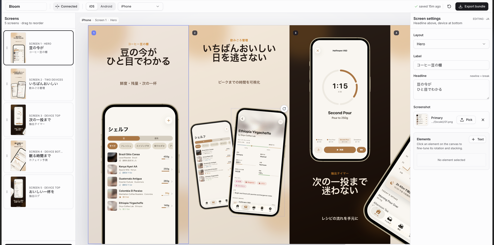

# App Store & Google Play Screenshots Generator

A Next.js visual editor and mobile capture pipeline for creating App Store and Google Play marketing screenshots. Includes live ADB screen capture, cross-platform system-bar sanitization, multiple iPhone hardware frames, a connected 2D canvas, automated palette and copy generation, and multi-resolution ZIP bundle export.

<p align="center">
  
  
  
  
  
</p>



> **Built on top of [Parth Jadhav's](https://www.parthjadhav.com/) [`app-store-screenshots`](https://github.com/ParthJadhav/app-store-screenshots) foundation with advanced mobile capture, cross-platform status-bar sanitization, multi-frame bezels, and 2D canvas extensions.** See [CREDITS.md](CREDITS.md) for full licensing and attribution details.

---

## Choose Your Workflow: AI Agent Skill or Standalone / Manual

You can run this project in two distinct ways depending on your setup:

### Option 1: Universal AI Agent Skill (Global AI Chat Execution)

Install this project as an agent skill into **Claude Code**, **Google Antigravity**, **Cursor**, **Windsurf**, or **OpenAI Codex**. Once installed, you can trigger screen capture, sanitization, copy generation, and editor setup simply by chatting with your AI agent in plain English.

#### 1-Click Installer (Global vs Project-Level)
You can choose whether to install the skill globally across your entire computer or isolate it within a single project repository:

```bash
# 1. Install as Global AI Skill (Claude Code & Antigravity across all your projects):
npm run install:global

# 2. Install inside the current project workspace only (.agents/skills & .claude/skills):
npm run install:project

# 3. Interactive prompt wizard (Choose Global, Project, or Custom path):
npm run install:skill
```

#### Manual / Direct Git Clone (Alternative)
```bash
# For Claude Code (Global):
git clone https://github.com/Abdullatariq47/advance_screenshots.git ~/.claude/skills/advance-screenshots

# For Google Antigravity (Global):
git clone https://github.com/Abdullatariq47/advance_screenshots.git ~/.gemini/config/skills/advance-screenshots

# For Cursor / Windsurf / Claude Code (within current project workspace):
git clone https://github.com/Abdullatariq47/advance_screenshots.git .agents/skills/advance-screenshots
```

> [!NOTE]
> **Upgrading from older `app-store-screenshots`:**
> If you previously installed the original upstream `~/.claude/skills/app-store-screenshots`, keeping this under `advance-screenshots` prevents upstream changes from breaking your setup. If you prefer replacing the old skill directly, backup your old folder (`mv ~/.claude/skills/app-store-screenshots ~/.claude/skills/app-store-screenshots.bak`) and clone this repository in its place.

#### How to Run with AI Chat
In any chat session with your AI agent, type natural language instructions:
- *"Capture screens from my connected phone for app `com.example.app` and build App Store screenshots."*
- *"Take manual screenshots with `+` and generate high-converting marketing copy."*
- *"Open the screenshot editor and design a two-device marketing slide."*
- *"Convert my Android screenshots to clean iPhone frames with dynamic island safe-area padding."*

Your AI agent will automatically detect the skill via `SKILL.md`, orchestrate ADB mobile capture, synthesize status bars, write marketing copy, and launch the visual editor for you.

---

### Option 2: Standalone / Manual Run (No AI Agent Needed)

For developers, designers, or QA teams who prefer a direct terminal CLI and web browser workflow without needing an AI coding agent:

#### Quick Automated Setup (Recommended for Mobile Devs)
Whether you are a native Swift/Xcode developer or Kotlin/Android Studio developer, you don't need to manually configure Node:

```bash
# On macOS / Linux (auto-detects Node, installs via Homebrew if missing):
chmod +x setup.sh && ./setup.sh

# On Windows (auto-detects Node, installs via winget if missing):
.\setup.ps1
```
*(If Node.js and npm are already installed on your machine, the scripts detect them automatically and skip re-installation).*

Or install manually if you already use npm:
```bash
npm install && npm --prefix template install
```

#### Manual Run Commands
```bash
# A. Interactive Terminal Snapper (Press [+] or Enter on connected device)
npm run capture:manual -- --appId com.example.app

# B. Web Connected-Canvas Visual Editor (http://localhost:3000)
npm run editor:dev

# C. Automated Capture Pipeline (UI tree inspection & guided setup)
npm run pipeline

# D. Batch Reprocess Static PNGs from disk
npx tsx scripts/reprocess-existing-slides.ts com.example.app
```

---

## Modes of Usage Overview

Choose the workflow that fits your release process. Complete flags, API routes, and troubleshooting live in **[docs/USAGE_MODES.md](docs/USAGE_MODES.md)**.

| Mode | Command | Best For |
|---|---|---|
| **1. Automated Capture Pipeline** | `npm run pipeline` (`--quick` / `--no-server`) | Guided setup, UI tree navigation, capture, sanitization, copy & theme generation |
| **2. Manual Terminal Capture** | `npm run capture:manual -- --appId <pkg>` | Navigating on a real phone/emulator and snapping screens with `+` or `Enter` |
| **3. Web Visual Editor** | `npm run editor:dev` -> `http://localhost:3000` | Interactive layout, 2D drag across screens, Style Lab, Dual Devices, ZIP export |
| **4. Batch Reprocess Static PNGs** | `npx tsx scripts/reprocess-existing-slides.ts <appId>` | Converting existing captures into clean iOS/Android assets and updating decks |

### Capture & Copy Pipeline Details

- **Dual-Platform Device Auto-Detection:** Automatically discovers booted iOS Simulators (`xcrun simctl`), physical iPhones (`devicectl` / `idevice_id`), and Android phones/emulators (`adb devices`). On macOS with an iPhone connected, it automatically chooses iOS without launching Android ADB.
- **Smart User-Interaction Handshake:** When running the autonomous pipeline (`agent-executor.ts`), if the app lands on a Login, OTP, 2FA, or onboarding screen without automated credentials, the AI gracefully pauses, displays an interactive alert, waits for the operator to log in on device, and seamlessly continues auto-navigating.
- **Local UI-Metadata Copy Engine (Default):** `manual-operator.ts` and `vision-copywriter.ts` extract visible on-screen UI hierarchy text (`slide-*.meta.json` via `uiautomator`) and derive screen-specific labels and headlines offline with no external API keys required.
- **Optional Cloud Vision Copywriting:** Add `ANTHROPIC_API_KEY`, `OPENAI_API_KEY`, or `GEMINI_API_KEY` in `.env` (see `.env.example`) to use external vision models instead of the offline engine.
- **Cross-Platform Sanitization (`scripts/system-bar-cropper.ts`):** Removes Android status bar icons, preserves bottom navigation tabs, extends the clean header seamlessly to Apple's `1320/2868` screen aspect (`1080×2347`) with no black letterbox padding, and composites a contrast-aware `9:41` status bar.

---

## Editor Features

- **Connected Canvas & 2D Drag** — drag devices, captions, images, and badges freely across screen boundaries with subtle magnetic snapping to screen centers and shared seams, or switch to **Isolated** mode.
- **Multiple iPhone Hardware Frames (`Auto` + 4 Styles)** — set deck-wide in the toolbar or per screen in the inspector:
  - `Auto (Smart Fit)` — inspects each screenshot's top center and selects notch-free **`Clean Pro`** whenever logos or tight headers would collide with the Dynamic Island.
  - `Clean Pro (No Notch)` — edge-to-edge dark titanium bezel with speaker slit tucked inside the frame rim.
  - `Silver Titanium (No Notch)` — brushed silver aluminum bezel with zero screen cutout.
  - `Matte Studio (No Notch)` — minimalist ceramic matte unibody bezel.
  - `Dynamic Island` — Apple's `public/frames/iphone-portrait.png` bezel.
- **Dual-Device Layouts Per Screen** — switch any slide between `1 Device` and `2 Devices` with `Front Right`, `Front Left`, `Side by Side`, and `3D Stacked` presets plus device opacity (`40%–100%`).
- **Auto Theme & App Presets** — detect a matching palette and backdrop from captured screenshots (`/api/auto-theme`) or apply 7 built-in presets (`Yuka`, `Revolut`, `Linear`, `Blinkist`, `Duolingo`, `Airbnb`, `Raycast`).
- **Style Lab & Scene Playground** — preview 4 complete looks side by side, lock Colors / Type / Layout / Scene individually, save favorites, and tune backdrop, glow, shadow, 3D tilt, headline scale, weight, and case globally.
- **Callouts, Overlays & Localization** — circular/rounded zoom loupes, PNG/JPG overlays with directional edge fades, WOFF2/WOFF/TTF/OTF font imports, multi-locale decks with RTL-aware layout, and 50-step Undo/Redo.
- **Store Export Bundle** — exports opaque 24-bit RGB PNGs bundled as a ZIP organized by `platform/device/WxH/locale/`, waiting for full image decode before writing frames.
- **Autosave & Multi-Project Sync** — persists `schemaVersion: 3` state to `template/app-store-screenshots.json` (plus `localStorage` mirror and ETag conflict protection) alongside `projects/<appId>/`.

---

## Optional Skill & MCP Integration

Conforms to the `SKILL.md` package format (`skills/advance-screenshots/` and `.agents/skills/advance-screenshots/`) and includes a Model Context Protocol server (`tools/mobile-capture-mcp/`):

```bash
# Install the skill package into your AI IDE
npx skills add https://github.com/Abdullatariq47/advance_screenshots.git

# Build and start the local capture MCP server
npm run mcp:build
npm run mcp:start
```

---

## Repository Structure

```text
.
├── docs/
│   ├── USAGE_MODES.md                 # Full CLI, API, editor, and troubleshooting guide
│   └── retrospectives/navigation.md
├── scripts/
│   ├── run-pipeline.ts                # Interactive & quick capture pipeline orchestrator
│   ├── manual-operator.ts             # Live ADB terminal snapper (+) with UI XML extraction
│   ├── agent-executor.ts              # Headless device navigation & capture runner
│   ├── system-bar-cropper.ts          # Cross-platform iOS 9:41 safe-area & Android cropper
│   ├── vision-copywriter.ts           # Offline UI XML + optional Vision API copywriter
│   ├── auto-theme-detector.ts         # Palette & scene extractor from captured screenshots
│   ├── generate-project-state.ts      # Balanced slide deck builder (schemaVersion 3)
│   ├── reprocess-existing-slides.ts   # Batch iOS/Android sanitizer for existing PNGs
│   └── kill-server.ts                 # Port-3000 process cleanup helper
├── template/                          # Next.js 16 + Tailwind + shadcn/ui visual editor
│   ├── app-store-screenshots.json     # Active deck state
│   ├── public/frames/                 # Apple Design Resources bezels
│   └── src/
│       ├── app/api/                   # /project, /frames, /capture-device, /auto-theme, /upload
│       ├── components/editor/         # Toolbar, Canvas, Device Frames, Inspector, Style Lab
│       └── lib/                       # Constants, Contrast, Export, Scene, Validation, Storage
├── tools/mobile-capture-mcp/          # MCP server for mobile navigation & capture
├── projects/<appId>/                  # Isolated per-app captures & saved decks (gitignored)
├── skills/advance-screenshots/        # Canonical skill definition, copy formulas & style specs
├── CREDITS.md                         # Attribution, bezel license notice & open-source stack
├── CONTRIBUTING.md                    # Contributor guidelines & test workflows
└── LICENSE                            # MIT License
```

See [template/README.md](template/README.md) for editor internals and iPhone Duo documentation.

---

## Export Sizes

### Apple App Store

| Device | Resolution |
|---|---|
| iPhone 6.9" | 1320 x 2868 |
| iPhone 6.5" | 1284 x 2778 |
| iPhone 6.3" | 1206 x 2622 |
| iPhone 6.1" | 1125 x 2436 |
| iPad 13" | 2064 x 2752 |
| iPad Pro 12.9" | 2048 x 2732 |
| Apple TV | 3840 x 2160, 1920 x 1080 |
| Apple Watch Ultra | 422 x 514, 410 x 502 |
| Apple Watch Series 10 / 7 / 4 / 3 | 416 x 496, 396 x 484, 368 x 448, 312 x 390 |
| CarPlay (iPhone slot, landscape) | 2868 x 1320, 2778 x 1284, 2622 x 1206, 2436 x 1125 |
| iPhone Duo outer display | 1398 x 2034 portrait, 2034 x 1398 landscape |
| iPhone Duo inner display | 2007 x 2853 portrait, 2853 x 2007 landscape |

[`skills/advance-screenshots/iphone-duo.md`](skills/advance-screenshots/iphone-duo.md) documents iPhone Duo display pairings (`Folded + open`) and placement rules. Apple's product bezels in `template/public/frames/` are licensed by Apple for mock-ups of apps for Apple platforms only.

### App Store Creative Assets & Mac App Store

| Asset | Resolution |
|---|---|
| Universal (header + search results) | 5244 x 2950 |
| Product page header | 3840 x 1646 |
| Search results (3:2) | 3840 x 2560, 1920 x 1280 |
| Mac (16:10) | 2880 x 1800, 2560 x 1600, 1440 x 900, 1280 x 800 |

### Google Play Store

| Device | Resolution |
|---|---|
| Phone portrait | 1080 x 1920 |
| 7" tablet portrait / landscape | 1200 x 1920 / 1920 x 1200 |
| 10" tablet portrait / landscape | 1600 x 2560 / 2560 x 1600 |
| Feature graphic | 1024 x 500 |

---

## Styles & Copywriting

Ships with **18 named visual styles** in [`skills/advance-screenshots/style-prompts/`](skills/advance-screenshots/style-prompts/) and category copy formulas in [`skills/advance-screenshots/copy-ideas.md`](skills/advance-screenshots/copy-ideas.md) (also available inside the editor's **Copy ideas** menu).

---

## Verification & Production Checks

```bash
# Root TypeScript check
npx tsc --noEmit

# Editor TypeScript check + production build
npm --prefix template run typecheck
npm --prefix template run build

# MCP server build
npm run mcp:build
```

---

## Contributing

Contributions are welcome. Read [CONTRIBUTING.md](CONTRIBUTING.md) before opening a PR.

## Credits & License

- Created by **[Parth Jadhav](https://www.parthjadhav.com/)** — licensed under the **[MIT License](LICENSE)**.
- Full attributions, Apple Design Resources bezel licensing notice, and third-party open-source credits are listed in **[CREDITS.md](CREDITS.md)**.
